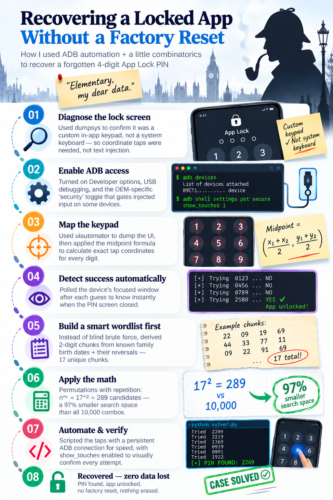

# Recovering a Forgotten Gallery App Lock PIN — Vivo V2022 (Android 12)
<div>

</div>

## Context & Goal

This write-up covers recovering access to a Vivo V2022 running Android 12 (Funtouch OS / OriginOS), where the **App Lock** PIN protecting a specific app was forgotten, and the built-in recovery flow (security questions) was also unusable because those answers were forgotten too.

The phone itself was unlocked and usable — this was not a full device lockout. Only the App Lock feature gating one app's access was the obstacle. The goal was to recover the PIN and the app's data **without triggering a factory reset or any data-destructive recovery path**, since a reset would destroy exactly the data being recovered.

> If anyone have bad-usb he/she can try with this but during this, I did not have amy bad-usb.

---

## 0. Prerequisites — Enabling ADB Access on the Device

ADB (Android Debug Bridge) is disabled by default on all Android devices as a security measure. It must be explicitly enabled via Developer options before any of the following steps work.

### Step 1 — Enable Developer options

1. Open **Settings > About phone**.
2. Scroll to find **Build number** (on some Vivo builds, labeled **Software version** instead).
3. Tap it **7 times in rapid succession**. After a few taps, a countdown toast appears ("You are now 3 steps away from being a developer," etc.). On the final tap, a confirmation appears: *"You are now a developer!"*
4. If prompted, enter the device's screen lock (PIN/pattern/password) to confirm — this is Android's safeguard to prevent enabling developer tools without physical device authentication.

### Step 2 — Enable USB debugging

1. Inside **Developer options**, toggle on **USB debugging**.
2. A confirmation dialog appears warning about the security implications — accept it.
3. Connect the device to your computer via a USB data cable (not a charge-only cable — some cheaper cables only carry power, not data; if `adb devices` shows nothing, try a different cable first before troubleshooting software).
4. On the device screen, a prompt appears: **"Allow USB debugging?"** showing the host computer's RSA key fingerprint.
5. Tap **"Always allow from this computer"** (checkbox) and then **OK**. This whitelists your computer's ADB key so future connections won't re-prompt.


### Step 3 — Verify the connection from the computer

```bash
adb devices
```

Expected output:
```bash
List of devices attached
<serial-number>    device
```

---

## 1. Identifying the Lock Screen / App Lock Activity

Before writing any automation, it's necessary to identify exactly **which window and activity** is presenting the PIN prompt, so the script can later detect when that screen closes (indicating success).

### Checking the currently focused window

```bash
adb shell dumpsys window | grep mCurrentFocus
```

With the App Lock PIN screen open on the device, this returns a line identifying the active window, typically in the form:
```bash
mCurrentFocus=Window{<hash> u0 <package>/<activity>}
```

For Vivo's secure PIN prompts, the activity has historically appeared as something like:
```bash
com.android.settings/com.vivo.settings.secret.PasswordActivity
```

**Important:** confirm this on the actual device and app in question, since:
- The exact activity name differs between Funtouch OS and OriginOS versions, and between Android 11/12/13 releases.
- App Lock specifically (a per-app lock feature, usually under **i Manager** or **Settings > App Lock** on Vivo) may use a different activity than the device's main lock screen PIN, even though both can look visually similar.
- Confusing the two is a meaningful risk (see the warning in Section 4) — the device's main lock screen can have very different failure consequences than an in-app lock.

### Confirming whether it's a system keyboard or a custom keypad

```bash
adb shell dumpsys input_method | grep -E "mInputShown|mServedView"
```

Two possible outcomes:

**A) A system IME (keyboard) is involved:**
```bash
mInputShown=true
mServedView=... (a standard EditText or similar)
```
In this case, `adb shell input text 1234` or `adb shell input keyevent <codes>` should work directly — no coordinate-tapping needed.

**B) A custom in-app keypad is involved (the case encountered here):**
```bash
mInputShown=false
mServedView=com.vivo.settings.password.VivoMixKey{...}
```
`mInputShown=false` confirms no system keyboard is attached. The `mServedView` pointing to a custom `Button`-based view (`VivoMixKey` in this case) confirms the PIN pad is drawn directly by the app itself as a grid of buttons — meaning `input text`/`input keyevent` have nothing to inject into, and **simulated taps on the actual on-screen button coordinates are required instead.**

You can further confirm there's no IME window active:
```bash
adb shell dumpsys window | grep -E "ITYPE_IME"
```
Look for `visible=false` on the IME inset source — this corroborates that no keyboard overlay is present.

---

## 2. Finding the Keypad Button Coordinates

### Dumping the UI hierarchy

With the PIN pad visible on screen:
```bash
adb shell uiautomator dump /sdcard/ui.xml
adb pull /sdcard/ui.xml
```

`uiautomator dump` walks the entire visible UI tree and writes an XML snapshot describing every visible element — its type, resource ID, text, and crucially, its exact pixel bounds on screen.

Filter for the relevant buttons:
```bash
grep -o 'resource-id="[^"]*key[^"]*"[^>]*bounds="[^"]*"' ui.xml
```

This returns lines like:
```bash
resource-id="com.android.settings:id/key1" bounds="[17,1715][354,1839]"
resource-id="com.android.settings:id/key2" bounds="[371,1715][708,1839]"
resource-id="com.android.settings:id/key3" bounds="[725,1715][1063,1839]"
...
resource-id="com.android.settings:id/key0" bounds="[371,2138][708,2208]"
resource-id="com.android.settings:id/key_c" bounds="[17,2138][354,2208]"
resource-id="com.android.settings:id/key_del" bounds="[725,2138][1063,2208]"
```


### Understanding `bounds` and calculating the tap point

Each `bounds="[x1,y1][x2,y2]"` string describes a rectangle: `(x1,y1)` is the **top-left** corner, `(x2,y2)` is the **bottom-right** corner, in screen pixels. Android's coordinate origin `(0,0)` is the top-left of the screen, with **Y increasing downward** (opposite of typical math-class graphs, where Y increases upward).

The safest point to tap within that rectangle is its **geometric center** — found using the standard midpoint formula from coordinate geometry:

#### Midpoint Formula

$$
\text{Midpoint} = \left( \dfrac{x_1 + x_2}{2},\ \dfrac{y_1 + y_2}{2} \right)
$$

$$
x_{\text{center}} = \dfrac{x_1 + x_2}{2}
\qquad
y_{\text{center}} = \dfrac{y_1 + y_2}{2}
$$

**Example — Key "1"** (`bounds="[17,1715][354,1839]"`)

$$
x_{\text{center}} = \dfrac{17 + 354}{2} = \dfrac{371}{2} = 185.5 \approx 185
$$

$$
y_{\text{center}} = \dfrac{1715 + 1839}{2} = \dfrac{3554}{2} = 1777
$$

**Example — Key "4"** (`bounds="[17,1856][354,1980]"`)

$$
x_{\text{center}} = \dfrac{17 + 354}{2} = 185
$$

$$
y_{\text{center}} = \dfrac{1856 + 1980}{2} = \dfrac{3836}{2} = 1918
$$


### Full coordinate table (example — must be re-derived for the actual V2022 screen/layout)


```
 1    2    3
 4    5    6
 7    8    9
 C    0    ⌫
```


| Key | Bounds | Tap center (x, y) |
|---|---|---|
| 1 | `[17,1715][354,1839]` | 185, 1777 |
| 2 | `[371,1715][708,1839]` | 539, 1777 |
| 3 | `[725,1715][1063,1839]` | 894, 1777 |
| 4 | `[17,1856][354,1980]` | 185, 1918 |
| 5 | `[371,1856][708,1980]` | 539, 1918 |
| 6 | `[725,1856][1063,1980]` | 894, 1918 |
| 7 | `[17,1997][354,2121]` | 185, 2059 |
| 8 | `[371,1997][708,2121]` | 539, 2059 |
| 9 | `[725,1997][1063,2121]` | 894, 2059 |
| C (clear) | `[17,2138][354,2208]` | 185, 2173 |
| 0 | `[371,2138][708,2208]` | 539, 2173 |
| Del (delete) | `[725,2138][1063,2208]` | 894, 2173 |

*These exact numbers are only valid for the specific screen resolution and layout they were measured from.* 

### Automating the extraction (avoids manual arithmetic for every key)

```python
import re

def center_from_bounds(bounds_str):
    x1, y1, x2, y2 = map(int, re.findall(r'\d+', bounds_str))
    return (x1 + x2) // 2, (y1 + y2) // 2

print(center_from_bounds("[17,1715][354,1839]"))
```

---

## 3. Detecting Whether the PIN Attempt Succeeded

### The core idea

After entering a guess, the script needs a reliable way to know whether it was accepted (PIN screen closes) or rejected (PIN screen stays, usually clearing the entered digits). This is done by polling the device's focused window.

### Polling with a timeout

```python
import subprocess, time

def keypad_visible():
    out = subprocess.check_output(
        ["adb", "shell", "dumpsys window"],
        shell=False
    ).decode()
    return "I=com.android.settings/com.vivo.settings.secret.PasswordActivity" in out   

def check_correct(timeout=0.6, poll=0.3):
    start = time.time()
    while keypad_visible():
        if time.time() - start > timeout:
            return False   # lock screen showing after timeout -> treat as wrong
        time.sleep(poll)
    return True             # treat as correct
```

**Step-by-step logic:**
1. `start = time.time()` records the moment checking begins.
2. The `while keypad_visible():` loop keeps checking as long as the PIN screen is still the focused window.
3. Each iteration, `time.time() - start` computes elapsed seconds since the check began.
4. If that exceeds `timeout` (0.6s here), the function gives up and returns `False` — this guess is treated as wrong.
5. If instead `keypad_visible()` becomes `False` on its own — meaning the window closed — the `while` loop exits naturally (without hitting the `return False` inside it), and the function falls through to `return True`.
6. `poll` (0.1s) is the pause between successive checks, balancing responsiveness against spamming the device with queries.


---

## 4. Automating the Full 4-Digit PIN Attempt

### Complete script

```python
import subprocess, time, itertools

KEYS = {
    "1": (185, 1777), "2": (539, 1777), "3": (894, 1777),
    "4": (185, 1918), "5": (539, 1918), "6": (894, 1918),
    "7": (185, 2059), "8": (539, 2059), "9": (894, 2059),
    "C": (185, 2173), "0": (539, 2173), "D": (894, 2173),
}

def press_fast(seq):
    cmds = " && ".join(f"input tap {KEYS[ch][0]} {KEYS[ch][1]}" for ch in seq)
    subprocess.run(["adb", "shell", cmds], check=True)

def keypad_visible():
    out = subprocess.check_output(["adb", "shell", "dumpsys", "window"]).decode()
    return "I=com.android.settings/com.vivo.settings.secret.PasswordActivity" in out

def check_correct(timeout=0.6, poll=0.3):
    start = time.time()
    while keypad_visible():
        if time.time() - start > timeout:
            return False
        time.sleep(poll)
    return True

if __name__ == "__main__":
    total = 10000
    tried = 0
    start_time = time.time()

    for number in range(0000, 10000):
        pin = f"{number:04d}"
        tried += 1
        print("Password Tried: " + pin)
        press_fast(pin)

        if check_correct():
            elapsed = time.time() - start_time
            print(f"\nCracked !!!!!!!!!! : {pin} !!!!!!!!!!!!")
            break

        if tried % 100 == 0:
            elapsed = time.time() - start_time
            rate = tried / elapsed
            remaining = (total - tried) / rate
            print(f"[{tried}/{total}] last tried: {pin}  (~{remaining/60:.1f} min remaining)")
    else:
        print("All 10,000 combinations, no match found.")
```

### Why `press_fast` batches taps into one `adb shell` call

```python
cmds = " && ".join(f"input tap {KEYS[ch][0]} {KEYS[ch][1]}" for ch in seq)
subprocess.run(["adb", "shell", cmds], check=True)
```

Rather than calling `subprocess.run()` four separate times (once per digit) — each of which spawns a new `adb` process and pays connection overhead — this builds a single shell command string chaining all four taps with `&&`, so they execute sequentially on the device within **one** ADB invocation. For a 4-digit PIN, this cuts 4 process-spawns down to 1 per attempt, which adds up meaningfully across thousands of attempts.

---
 
## 5. Smart Targeted Wordlist — DOB-Based PIN Reduction
 
### Scenario
 
Trying all $10{,}000$ possible 4-digit combinations works but is slow, since every attempt on real hardware costs real time (a tap cycle plus a verification check, not an instant comparison). In practice, people very commonly build PINs from something memorable — most often a birth date of their own or a close family member, split into 2-digit chunks (day, month, or the last two digits of the year). If the PIN owner's and their close family's birth dates are known, this pattern can be exploited to build a **much smaller, targeted candidate list** to try first, falling back to the full 10,000-combination brute force only if none of the targeted guesses succeed. This is exactly what was used during this recovery.
 
### Step 1 — Build the base set from known DOBs
 
Take the relevant birth dates (here: the PIN owner's, and their mother's and father's) and split each into its 2-digit components — day, month, and the last two digits of the year.
 
**Example dates:** `22/09/1969`, `28/12/1976`, `08/11/1999`
 
$$
S = \{22,\ 09,\ 19,\ 69,\ 28,\ 12,\ 76,\ 08,\ 11,\ 99\}
$$
 
$$
|S| = 9
$$
 
### Step 2 — Add digit-reversals
 
People sometimes enter a date component reversed (e.g. `90` instead of `09`), so each number's digit-reversal is added as well — except where reversing changes nothing, which happens for palindromic two-digit numbers like `11` or `99`.
 
$$
S_r = \{\ \text{reverse}(n)\ :\ n \in S,\ \ \text{reverse}(n) \neq n\ \}
$$
 
### Step 3 — Union and deduplicate
 
$$
U = S \cup S_r \qquad n = |U|
$$
 
For the example dates above, this produces $n = 17$ unique two-digit chunks (always re-verify the final deduplicated count for a given set of dates rather than assuming it carries over).
 
### Step 4 — Counting the candidate PINs (permutations with repetition)
 
A 4-digit PIN is formed by picking **two chunks from $U$ and concatenating them** — e.g. $22 \,\Vert\, 09 \rightarrow \texttt{2209}$.
 
This is **permutations with repetition allowed**, because:
- **Order matters** — $22\,\Vert\,09 = \texttt{2209}$ differs from $09\,\Vert\,22 = \texttt{0922}$.
- **Repetition is allowed** — the same chunk can be picked twice, e.g. $22\,\Vert\,22 \rightarrow \texttt{2222}$, a realistic PIN pattern.
The formula for permutations of $r$ positions filled from $n$ items **with repetition**:
 
$$
P(n, r) = n^r
$$
 
With $r = 2$ (two chunks concatenated to form a 4-digit PIN) and $n = 17$:
 
$$
\text{Total candidate PINs} = n^r = 17^2 = 289
$$
 
**Why this formula and not the others:**
 
| Formula | What it counts | Applies here? |
|---|---|---|
| $\dbinom{n}{r} = \dfrac{n!}{r!\,(n-r)!}$ | Combinations: order doesn't matter, no repetition |  No — PIN digit order matters |
| $P(n,r) = \dfrac{n!}{(n-r)!}$ | Permutations: order matters, no repetition |  No — the same chunk can repeat |
| $n^r$ | Permutations **with repetition**: order matters, repetition allowed |  Yes — matches this scenario exactly |
 
### Step 5 — Comparing against full brute force
 
$$
\frac{289}{10{,}000} = 0.0289 \quad (2.89\%\ \text{of the full space})
$$
 
$$
\text{Reduction} = 1 - 0.0289 = 0.9711 \quad (\approx 97.1\%\ \text{fewer attempts})
$$
 
### Summary table
 
| Quantity | Value |
|---|---|
| Base DOB chunks ($S$) | 9 |
| New chunks added from reversal ($S_r$) | up to 8 (fewer if some reversals duplicate existing chunks) |
| Total unique chunks ($n = \lvert U \rvert$) | 17 (example-specific — recompute for other dates) |
| Chunks combined per PIN ($r$) | 2 |
| Counting formula | $n^r$ (permutations with repetition) |
| Total candidate PINs | $17^2 = 289$ |
| Full brute-force space | $10{,}000$ |
| Search space reduction | $\approx 97.1\%$ |
 
### General formula for reuse
 
$$
\boxed{\text{Candidate PINs} = n^r}
$$
 
This generalizes beyond 4-digit PINs: for a 6-digit PIN built from three 2-digit chunks ($r = 3$) drawn from the same 17-chunk set, the candidate count would be $17^3 = 4{,}913$ — still a substantial reduction from the full $10^6 = 1{,}000{,}000$ brute-force space (≈99.5% reduction).
 
### Source-code — generating the wordlist
 
```python
def reverse_digits(n: int) -> int:
    s = f"{n:02d}"
    return int(s[::-1])

def build_dob_wordlist(dob_chunks):
    dob_set = set(dob_chunks)    
    reversed_set = {reverse_digits(x) for x in dob_set if reverse_digits(x) != x}
    full_set = dob_set | reversed_set  
    wordlist = []
    for a in full_set:
        for b in full_set:
            pin = f"{a:02d}{b:02d}"     
            wordlist.append(pin)
    return wordlist, full_set

if __name__ == "__main__":
    dob_set = {22, 9, 19, 69, 28, 12, 76, 8, 11, 99}
    wordlist, full_set = build_dob_wordlist(dob_set)
    with open("dob_wordlist.txt", "w") as f:
        f.write("\n".join(wordlist))
```
 
---

## 6. Estimated Time for a 4-Digit PIN

### Where the time actually goes

Each attempt requires at least two ADB round trips: one to send the taps, one to check whether the PIN screen closed. The dominant cost in each is **I/O wait** — USB/ADB protocol negotiation and device-side command processing — not the Python script's own execution time.

| Setup | Approx. per-attempt time | Total for 10,000 attempts |
|---|---|---|
| `subprocess` per call, full unfiltered `dumpsys window` check | ~1.0-1.1s | ~2.8-3 hours |
| Persistent connection via `adb-shell` library | May be give better result | :) |

### Why a persistent connection matters more than language (C++,C,Rust etc.) choice

A natural instinct when something feels slow is to rewrite it in a faster language (C++, Rust, etc.). In this case, that would **not** meaningfully help, because the bottleneck isn't CPU-bound script execution — it's the overhead of spawning a brand-new `adb` process and renegotiating a connection for every single command. That overhead (typically 50-200ms per `adb` invocation) exists regardless of which language issues the call, since it happens at the ADB protocol/process level, outside the script entirely.

The actual fix is **connection reuse**: open one ADB connection and keep it alive for the whole run, issuing all 10,000+ commands over that same connection instead of spawning a new process each time.

---

## 7. Full Summary of the Recovery Process

1. **Enabled ADB access**: Developer options, standard USB debugging, and the Vivo-specific "USB debugging (Security settings)" toggle (the latter being the actual fix for early "nothing happens" symptoms).
2. **Identified the lock screen**: confirmed via `dumpsys window` and `dumpsys input_method` that the App Lock PIN prompt used a custom in-app keypad (`VivoMixKey`), not a system keyboard — meaning tap-based input, not text injection, was required.
3. **Extracted exact button coordinates**: used `uiautomator dump` to get each digit button's screen bounds, then applied the midpoint formula to calculate reliable tap points.
4. **Built a success-detection check**: polled `dumpsys window`'s focused-window info after each guess to detect when the PIN screen closed.
5. **Confirmed the field auto-cleared on a wrong guess**, simplifying the automation loop (no explicit clear step needed).
6. **Verified there was no lockout/wipe mechanism** on this specific App Lock feature before proceeding with automated brute force.
7. **Ran the brute-force script** across all 10,000 possible 4-digit combinations, tapping each and checking for success.
9. **Visually confirmed success** using `show_touches` and `pointer_location` during the run, and by observing the expected unlocked screen once the script reported the matching PIN.

This recovered full access to the app and its data without resorting to a factory reset, which would have erased everything the recovery was meant to preserve.

---

## Appendix — Quick Reference Checklist
- [ ] https://www.vivo.com/en/support/questionList?FAQId=86219&categoryId=53689 - Vivo does not have rate limiting.
- [ ] Developer options enabled (tap Build number 7x)
- [ ] USB debugging enabled
- [ ] USB debugging (Security settings) enabled — Vivo-specific, required for injected taps to actually register
- [ ] `adb devices` shows `device` (not `unauthorized`/`offline`)
- [ ] Confirmed via `dumpsys window` / `dumpsys input_method` whether target is a custom keypad or system IME
- [ ] Captured fresh `uiautomator dump` with the PIN pad visible on the actual V2022 screen
- [ ] Calculated tap coordinates for all digits (and clear/delete keys if present) using the midpoint formula
- [ ] Confirmed whether wrong guesses auto-clear the field
- [ ] **Confirmed there is no lockout/wipe mechanism before running a full brute-force loop** — stopped and reassessed if this is actually the main device lock screen rather than an in-app lock
- [ ] Verified tap accuracy visually (`show_touches`, optionally `scrcpy`) before leaving the script to run unattended
- [ ] (Optional, for speed) Set up persistent ADB connection via `adb-shell` instead of per-call `subprocess` invocations